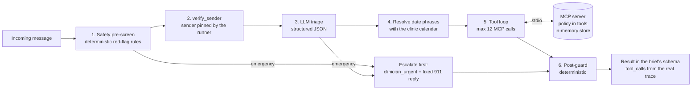

# Maplewood Clinic Inbox Agent

An AI front-desk agent for a fictional outpatient clinic. It reads each patient message, acts through an MCP
tool server over the clinic's data, escalates to humans when it should, and is measured against labelled
messages. Built for the Edvak Forge take-home (Product Engineer, AI and Rapid Prototyping).

Everything here is synthetic. Today is fixed at Monday 2026-11-09 by `data/clinic.json`.

## Quick start

```bash
make install                                   # Python (uv) and frontend (pnpm) dependencies
cp .env.example .env                           # add OPENROUTER_API_KEY (free models) or ANTHROPIC_API_KEY
make run && make eval                          # process the 40 sample messages, then score them
```

Then `make ui` and open http://localhost:8000 for the console: process an unseen message live, browse every
result with its tool trace, see the staff queues and the schedule, and read the evaluation. For a terminal demo:
`uv run python -m agent.cli process --from "Robert Chen" --contact 555-0102 --text "Can I get my lisinopril refilled?" --json`.
`make help` lists every command.

<!-- RESULTS -->

## Architecture



Why it is built this way:

- **Layered safety, deterministic floor.** Red-flag rules run on every message before any model call, and an
  emergency is routed and answered with a fixed template before the LLM is even asked. A model outage, a refusal
  or a quota limit cannot delay an escalation (tested). The LLM triage can raise urgency, never lower it. Rules are
  biased to recall: negation never cancels an emergency rule ("no chest pain but my arm is numb" still fires),
  and idioms are removed as phrases ("dying to get in lol") so a real red flag in the same message still fires.
  The LLM layer catches what rules cannot: on the held-out set the rules alone caught 1 of 4 emergencies.
- **Policy lives in the tools, not the prompt.** Refill eligibility, slot validity, booking rules and verification
  are pure functions with unit tests (`clinic_mcp/policy/`). Booking, rescheduling and cancelling re-validate
  inside the tool, so the agent physically cannot book on leave, on a holiday, over lunch, off the 20-minute grid
  or into an overlap. `prepare_refill_for_approval` re-runs eligibility and can only create a pending request.
  The model never does date arithmetic: date phrases are resolved by the calendar tool before it starts.
- **Privacy at the tool boundary.** Patient-data tools need a `verification_token` that `verify_sender` issues
  only for a verified sender, bound to the current message and invalidated at the next one. The runner pins the
  sender's real name and contact, so text inside a message cannot change who gets verified. Unverified senders
  get `patient_id: null`, and the guard replaces any reply that names another patient or contains their
  appointment details.
- **The trace is the truth.** Tool-backed actions (book, cancel, prepare, route, flag, refill decisions) are
  derived from successful tool calls, never from what the model says it did. The model contributes only the
  conversational actions, and the guard applies their definitions (see Action vocabulary).
- **In-memory store, reset per run.** The data is small and the brief only needs state for a run, so a database
  would add setup without changing what is being judged. The store is a copy of the JSON files, reset at the start
  of every run; bookings, refill requests, routes and flags persist across messages within the run, which is what
  the double-booking and leave checks need.
- **Provider-agnostic.** The runner speaks one message format; `agent/llm.py` adapts it to OpenRouter (default,
  free models) or Anthropic. Switching is an environment variable.

### Action vocabulary

The brief's conversational actions have exact meanings, applied by the post-guard:

| Action | Means |
|---|---|
| `offer_appointment` | Visit times offered without booking (for example a refill that needs a visit) |
| `offer_alternatives` | What was asked for was impossible, so other times or providers were offered |
| `answer_directly` | A question answered from public clinic information (hours, holidays, new patients) |
| `acknowledge` | The reply only acknowledges; nothing else was done |

## What I reused and what I built

Reused: the official `mcp` Python SDK (MCP server and stdio client), the Anthropic Python SDK, OpenRouter's
API (free models, called with `httpx2`), Starlette and Uvicorn (already installed with the MCP SDK), React with
TanStack Router and Query, Zod, Tailwind and shadcn/ui from a team scaffold, pytest, vitest and MSW. I built with
Claude Code and its skills: superpowers (brainstorming, writing-plans, executing-plans, test-driven-development,
systematic-debugging, verification-before-completion), gstack `/qa` (browser QA in a visible Chromium) and the
Bearing React scaffold. The `mcp-builder` skill was not installed.

Built: the policy core (dates, verification, refill, scheduling), the token-gated tool layer and MCP server, the
safety pre-screen and post-guard, the runner and both LLM adapters, the evaluation harness (metrics, a check for
every `must_not` tag, held-out set, stability, cost and latency, Markdown report) and the console (API and React app).

## Model choice and cost

<!-- MODEL -->

## What I would do with another week

- Grow the labelled set to a few hundred messages, written by front-desk staff, with a held-out split, and get
  clinician sign-off on the labels.
- Replace the keyword pre-screen with a small fine-tuned classifier evaluated for recall at a fixed false-alarm
  rate, keeping the rules as a floor.
- Compare models properly (free OpenRouter models, Claude Haiku and Sonnet) on accuracy, stability and cost.
- Ask before acting on ambiguous requests in a multi-turn thread (the agent currently replies once).
- A Playwright end-to-end suite for the console in CI, and contract tests between the API and the frontend schemas.

## Before this touches real patient data

- A HIPAA Business Associate Agreement with the LLM vendor, zero data retention, and no free endpoints (free
  endpoints may log prompts). Self-hosting the model is the alternative.
- Authentication and authorisation on the console and on the MCP server (the `admin_` tools must be server-only).
- Audit logging of every tool call and every human decision, with retention rules; PHI minimisation and redaction
  in logs (run logs here contain synthetic patient data and are git-ignored).
- A human in the loop on every outbound reply (replies are drafts today) and monitoring with paging on the
  urgent clinician queue.
- Clinician review and sign-off of the red-flag rules, the emergency template and the escalation paths.
- A much larger labelled set, a red-team pass on prompt injection and identity spoofing, and load and failure tests.
- Real identity verification (two factors), not name plus date of birth.

## Repository

```
clinic_mcp/   store.py, policy/ (dates, verification, refill, scheduling), tools.py, server.py
agent/        safety.py (pre-screen, post-guard), runner.py, llm.py, prompts.py, schema.py, cli.py
eval/         metrics.py, must_not.py, harness.py, report.py, stability.py, holdout_*.json
console/      app.py (API for the web console, live runs over server-sent events)
web/          React console
tests/        unit, integration and regression tests
results/      results_*.json, eval_report*.md|json, stability.json (run logs are git-ignored)
docs/         design, plan, eval changelog
```

Checks: `make test` (Python), `make coverage` (fails under 95%), `make test-web` (format, lint, types, tests,
coverage floor, dependency audit).
