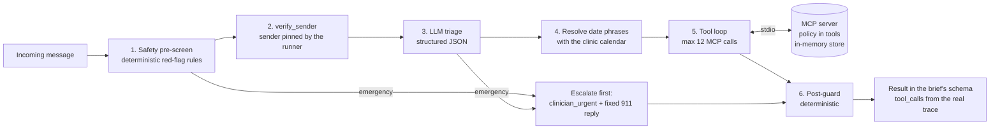

# Maplewood Clinic Inbox Agent

An AI front-desk agent for a fictional outpatient clinic. It reads each patient message, acts through an MCP
tool server over the clinic's data, escalates to humans when it should, and is measured against labelled
messages. Built for the Edvak Forge take-home (Product Engineer, AI and Rapid Prototyping).

Everything here is synthetic. Today is fixed at Monday 2026-11-09 by `data/clinic.json`.

## Quick start

Needs [uv](https://docs.astral.sh/uv/) (it installs Python 3.12, pinned in `.python-version`), Node 24 and pnpm.

```bash
make install                                   # Python and frontend dependencies
make eval                                      # re-score the committed results: no API key, about a second
make ui                                        # console at http://localhost:8000 (results, traces, queues, schedule)
```

To run the agent itself, copy `.env.example` to `.env` and add `OPENROUTER_API_KEY` (free models) or
`ANTHROPIC_API_KEY`. Then `make run && make eval` processes and scores the 40 sample messages (about 165 model
calls and 18 minutes on the free tier; it replaces the committed results), and the console's Live page processes
any new message end to end. Terminal demo:
`uv run python -m agent.cli process --from "Robert Chen" --contact 555-0102 --text "Can I get my lisinopril refilled?" --json`.
`make help` lists every command. Without a key, emergencies are still escalated and everything else falls back to
a human queue.

## Results

Measured with `make eval` and `make holdout` on 2026-10-22, model `nvidia/nemotron-3-ultra-550b-a55b:free`
via OpenRouter (3 of 164 calls fell back to `minimax/minimax-m3.1-flash:free`). The agent's output for each
message, in the brief's schema: [results/results_sample.json](results/results_sample.json) and
[results/results_holdout.json](results/results_holdout.json). Full reports with every wrong case, its tool trace
and a root-cause line: [results/eval_report.md](results/eval_report.md) and
[results/eval_report_holdout.md](results/eval_report_holdout.md). Per-message run logs (traces, guard decisions,
token usage) are in `results/runs/`.

| Metric | Sample (40) | Held-out (13) |
|---|---|---|
| Emergency recall | **100%** (5/5) | **100%** (4/4) |
| Emergency precision | 83.3% (M006 over-escalated) | 100% |
| must_not violations | **0** | **0** |
| Urgency accuracy | 97.5% | 100% |
| Exact action set | 90.0% | 69.2% (previous run: 100%) |
| Action micro P / R / F1 | 95.6% / 91.5% / 93.5% | 82.4% / 87.5% / 84.8% |
| Routing accuracy | 95.0% | 100% |
| patient_id accuracy | 95.0% | 100% |
| Intent set F1 | 95.0% | 86.9% |
| Cost of a full run | $0.00 (free model) | $0.00 |
| Latency p50 / p95 per message | 27.5s / 44.3s | 22.7s / 32.1s |

The held-out set (13 messages: new emergency phrasings, Spanish, a new injection, a caregiver not on file, a
holiday booking, multi-intent) was written before the first model run and never used to choose a change. On it,
the rules alone caught 1 of the 4 emergencies; LLM triage caught the other three (anaphylaxis with no textbook
words, indirect suicidal ideation inside a refill, downplayed cardiac symptoms).

How the numbers moved (details in [docs/CHANGELOG_EVAL.md](docs/CHANGELOG_EVAL.md)): exact action match went
from 35% to 90% on the sample after the action vocabulary was made exact and enforced, without any rule keyed
to a message or label. With no LLM at all (every model call failing), the deterministic layers alone keep
emergency recall at 100% and must_not violations at 0; everything else lands safely with a human.

Stability across repeated runs: the three-run check (`make stability`) on the final code is not measured yet; it
needs about 500 free requests and the daily quota went to the final runs. The evidence so far is two held-out runs
with the same prompt: safety identical (4/4 emergencies, 0 violations, 100% urgency, routing and patient_id), exact
actions 100% then 69.2%. The free model is not fully deterministic even at temperature 0 (OpenRouter can route to
different providers), and the differences are in conversational actions (H05, H07, H09), not in safety or routing.
One held-out miss (H06) was a real guard bug and is fixed: when the guard replaces a reply, the actions now describe
the reply that was sent.

### What the agent gets wrong

- **M006, over-escalation (kept on purpose).** "Some days I don't see the point of anything" inside a sertraline
  refill is escalated as a possible emergency. The label expects a same-day clinician route plus the refill. I chose
  not to tune the triage away from escalating possible suicidal ideation.
- **M019, urgency.** Ongoing post-surgical pain with an oxycodone request is rated urgent (label: routine). The
  routing to the prescribing provider is right.
- **M007, model variance.** The reply answers the new-patient question but the model left `answer_directly` off
  its action list in this run (it included it in the previous run).
- **Intent sets** are sometimes one intent wider than the label (for example `clinical` added to a refill).
- **Deliberate differences from the labels:** M011 and M027 get `patient_id: null` because the brief says so for
  unverified senders; M004 also routes to the provider because `refill_policy` says to; M022 asks which of two
  bookings tomorrow to cancel instead of guessing.
- **Known limits:** the agent replies once (no clarifying dialogue); keyword checks in the guard (clinical advice,
  status disclosure) are a net, not a proof; free models are slow (p50 about 27 seconds per message) and rate-limited.

### Quality evidence

- Browser QA in a visible Chromium (gstack `/qa`): 10 issues found, 10 fixed and re-verified, health 86 to 100;
  report and screenshots in [docs/qa/](docs/qa/qa-report-2026-10-22.md).
- Independent whole-branch code review: 8 findings (1 critical: the tool loop executed hidden admin tools if the
  model named them), all fixed with a test that failed first.
- Security pass: dependency audits clean (pip-audit, pnpm audit), path traversal, input validation, token
  redaction and cross-origin access pinned as tests (`tests/test_security.py`).
- `make check`: ruff, mypy (no issues), 346 Python tests at 96.7% line and branch coverage (floor 95%), and the
  frontend gate (format, ESLint, TypeScript, 80 tests, coverage floor, audit). Verified from a clean copy of the
  repository (install, tests, eval, frontend gate, build).

Time: the brief judges 6 to 8 hours. The agent, tools and evaluation fit that; the web console, the browser QA
and the review fixes went beyond it, and I would rather say so than hide it.

## Architecture



Why it is built this way:

- **Layered safety, deterministic floor.** Red-flag rules run on every message before any model call, and an
  emergency is routed and answered with a fixed template before the LLM is even asked. A model outage, a refusal
  or a quota limit cannot delay an escalation (tested). The LLM triage can raise urgency, never lower it. Rules are
  biased to recall: negation never cancels an emergency rule ("no chest pain but my arm is numb" still fires),
  and idioms are removed as phrases ("dying to get in lol") so a real red flag in the same message still fires.
  The LLM layer catches what rules cannot: on the held-out set the rules alone caught 1 of 4 emergencies.
- **Policy lives in the tools, not the prompt.** Refill eligibility, slot validity, booking rules and verification
  are pure functions with unit tests (`clinic_mcp/policy/`). Booking, rescheduling and cancelling re-validate
  inside the tool, so the agent physically cannot book on leave, on a holiday, over lunch, off the 20-minute grid
  or into an overlap. `prepare_refill_for_approval` re-runs eligibility and can only create a pending request.
  Date phrases the runner detects in a message ("el martes", "Wednesday 18th", "the following week") are resolved
  by the calendar tool before the model starts, and the prompt requires `resolve_date` for any other date.
- **Privacy at the tool boundary.** Patient-data tools need a `verification_token` that `verify_sender` issues
  only for a verified sender, bound to the current message and invalidated at the next one. The runner pins the
  sender's real name and contact, so text inside a message cannot change who gets verified. Unverified senders
  get `patient_id: null`, and the guard replaces any reply that names another patient or contains their
  appointment details.
- **The trace is the truth.** Tool-backed actions (book, cancel, prepare, route, flag, refill decisions) are
  derived from successful tool calls, never from what the model says it did. The model contributes only the
  conversational actions, and the guard applies their definitions (see Action vocabulary).
- **In-memory store, reset per run.** The data is small and the brief only needs state for a run, so a database
  would add setup without changing what is being judged. The store is a copy of the JSON files, reset at the start
  of every run; bookings, refill requests, routes and flags persist across messages within the run, which is what
  the double-booking and leave checks need.
- **Provider-agnostic.** The runner speaks one message format; `agent/llm.py` adapts it to OpenRouter (default,
  free models) or Anthropic. Switching is an environment variable.

### Action vocabulary

The brief's conversational actions have exact meanings, applied by the post-guard:

| Action | Means |
|---|---|
| `offer_appointment` | Visit times offered without booking (for example a refill that needs a visit) |
| `offer_alternatives` | What was asked for was impossible, so other times or providers were offered |
| `answer_directly` | A question answered from public clinic information (hours, holidays, new patients) |
| `acknowledge` | The reply only acknowledges; nothing else was done |

## What I reused and what I built

Reused: the official `mcp` Python SDK (MCP server and stdio client), the Anthropic Python SDK, OpenRouter's
API (free models, called with `httpx2`), Starlette and Uvicorn (already installed with the MCP SDK), React with
TanStack Router and Query, Zod, Tailwind and shadcn/ui from a team scaffold, pytest, vitest and MSW. I built with
Claude Code and its skills: superpowers (brainstorming, writing-plans, executing-plans, test-driven-development,
systematic-debugging, verification-before-completion), gstack `/qa` (browser QA in a visible Chromium) and the
Bearing React scaffold. The `mcp-builder` skill was not installed.

Built: the policy core (dates, verification, refill, scheduling), the token-gated tool layer and MCP server, the
safety pre-screen and post-guard, the runner and both LLM adapters, the evaluation harness (metrics, a check for
every `must_not` tag, held-out set, stability, cost and latency, Markdown report) and the console (API and React app).

## Model choice and cost

Default: `nvidia/nemotron-3-ultra-550b-a55b:free` on OpenRouter, the largest free model with tool calling on
2026-10-22, with `minimax/minimax-m3.1-flash:free` and `nvidia/nemotron-3-super-120b-a12b:free` as fallbacks if it
is busy. Temperature 0. A full sample run is about 165 model calls and costs $0.00; the free tier allows 1,000
requests a day on this account, so one day covers a run, the held-out set and some live demos, but not also the
three-run stability check. `openrouter/free` was rejected because it picks a random model per request, which
would make stability meaningless.

Anthropic is one variable away (`LLM_PROVIDER=anthropic`, `AGENT_MODEL=claude-sonnet-5-5` or `claude-haiku-5-5`).
The free run logged 164 calls, 841,505 input and 43,793 output tokens (about 5,100 in and 270 out per call).
At Anthropic list prices the same token counts would cost about $2.12 on Claude Sonnet 5.5, $0.11 on Haiku 5.5 and
$4.24 on Opus 5.5 per full sample run, before prompt caching. These are priced from the free run's token counts
(tokenizers differ), not measured Anthropic runs.

Why free first: the brief asks for honest measurement and a working demo, and a free model that reaches 100%
emergency recall and 0 must_not violations shows that safety comes from the architecture, not from an expensive
model. A production choice would be made by running the same eval across models.

Data layer: the in-memory store is right for this brief, not for a clinic. Production needs a database with
transactions and a unique constraint on (provider, date, start) so two concurrent bookings cannot both succeed;
today's single-process lock gives that guarantee only inside one console process.

## What I would do with another week

- Grow the labelled set to a few hundred messages, written by front-desk staff, with a held-out split, and get
  clinician sign-off on the labels.
- Replace the keyword pre-screen with a small fine-tuned classifier evaluated for recall at a fixed false-alarm
  rate, keeping the rules as a floor.
- Compare models properly (free OpenRouter models, Claude Haiku and Sonnet) on accuracy, stability and cost.
- Ask before acting on ambiguous requests in a multi-turn thread (the agent currently replies once).
- A Playwright end-to-end suite for the console in CI, and contract tests between the API and the frontend schemas.

## Before this touches real patient data

- A HIPAA Business Associate Agreement with the LLM vendor, zero data retention, and no free endpoints (free
  endpoints may log prompts). Self-hosting the model is the alternative.
- Authentication and authorisation on the console and on the MCP server (the `admin_` tools must be server-only).
- Audit logging of every tool call and every human decision, with retention rules; PHI minimisation and redaction
  in logs (the committed run logs contain synthetic patient data only; verification tokens are redacted).
- A human in the loop on every outbound reply (replies are drafts today) and monitoring with paging on the
  urgent clinician queue.
- Clinician review and sign-off of the red-flag rules, the emergency template and the escalation paths.
- A much larger labelled set, a red-team pass on prompt injection and identity spoofing, and load and failure tests.
- Real identity verification (two factors), not name plus date of birth.

## Repository

```
clinic_mcp/   store.py, policy/ (dates, verification, refill, scheduling), tools.py, server.py
agent/        safety.py (pre-screen, post-guard), runner.py, llm.py, prompts.py, schema.py, cli.py
eval/         metrics.py, must_not.py, harness.py, report.py, stability.py, holdout_*.json
console/      app.py (API for the web console, live runs over server-sent events)
web/          React console
tests/        unit, integration and regression tests
results/      results_*.json, eval_report*.md|json, runs/ (logs of the two final runs)
docs/         design, plan, eval changelog, qa/ (browser QA report and screenshots)
```

Checks: `make check` runs everything below. `make lint` (ruff, ruff format, mypy), `make test` (Python),
`make coverage` (fails under 95%), `make test-web` (format, lint, types, tests, coverage floor, dependency audit).
