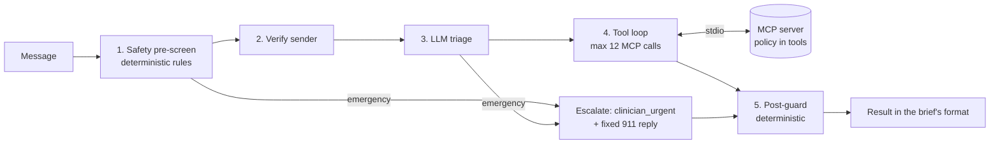

# Maplewood Clinic Inbox Agent

An AI front-desk agent for the fictional Maplewood Family Clinic. It reads each patient message, acts through an
MCP tool server over the clinic's data, escalates to a human when it should, and is measured against the labelled
sample. Everything is synthetic; today is fixed at Monday 2026-11-09.

## Run it

Needs [uv](https://docs.astral.sh/uv/) (installs Python 3.12), Node 24 and pnpm.

```bash
make install    # dependencies
make eval       # score the committed results on the 40 sample messages (no API key needed)
make ui         # console at http://localhost:8000: results, traces, and a Live page for new messages
```

To run the agent itself, copy `.env.example` to `.env` and set `OPENROUTER_API_KEY` (free models) or
`ANTHROPIC_API_KEY`. `make run && make eval` reprocesses and rescores the 40 messages (about 18 minutes on the free
tier). One new message from the terminal:

```bash
uv run python -m agent.cli process --from "Robert Chen" --contact 555-0102 --text "Can I get my lisinopril refilled?" --json
```

## Results on the 40 sample messages

Output per message, in the brief's format: [results/results_sample.json](results/results_sample.json). Full report
with every missed emergency, every `must_not` violation and every wrong case with its tool trace and root cause:
[results/eval_report.md](results/eval_report.md).

| Metric | Result |
|---|---|
| Emergency recall | **100%** (5/5) |
| `must_not` violations | **0** |
| Emergency precision | 83.3% (M006 over-escalated) |
| Urgency accuracy | 97.5% |
| Exact action set | 90.0% |
| Action micro precision / recall / F1 | 95.6% / 91.5% / 93.5% |
| Routing accuracy | 95.0% |
| patient_id accuracy | 95.0% |
| Cost of a full run | $0.00 (free model) |

A 13-message held-out set, written before the first model run and never used to tune, also scored 100% emergency
recall and 0 violations ([results/eval_report_holdout.md](results/eval_report_holdout.md)).

### What the agent gets wrong

- **M006, over-escalation (kept on purpose).** "Some days I don't see the point of anything" inside a sertraline
  refill is escalated as a possible emergency; the label expects a same-day clinician route plus the refill. I chose
  not to tune the agent away from escalating possible suicidal ideation.
- **M019, urgency.** Post-surgical pain with an oxycodone request is rated urgent (label: routine). Routing to the
  prescriber is correct.
- **M007, model variance.** The reply answers the new-patient question, but the model left `answer_directly` off its
  actions in this run.
- **Intent sets** are sometimes one intent wider than the label.
- **Deliberate differences from the labels:** M011 and M027 get `patient_id: null` because the brief says so for
  unverified senders; M004 also routes to the provider because the refill policy says to; M022 asks which of two
  bookings tomorrow to cancel instead of guessing (its committed output has an empty action list; the guard now sets
  `acknowledge`, fixed after the run).
- **Limits:** the agent replies once (no clarifying dialogue); keyword checks are a safety net, not a proof; the free
  model is slow (about 27 seconds per message) and not fully deterministic between runs.

## Architecture and why



- **Safety has a deterministic floor.** Red-flag rules run before any model call, and an emergency is routed and
  answered with a fixed 911 template before the LLM is asked anything, so a model outage cannot delay it. LLM triage
  can raise urgency, never lower it, and catches what rules miss (3 of the 4 held-out emergencies).
- **Policy lives in the tools, not the prompt.** Refill eligibility, booking rules (hours, lunch, holidays, leave,
  overlaps, the 20-minute grid) and verification are tested functions inside the MCP tools, so the agent cannot book
  on leave or prepare a controlled-substance refill however it is prompted.
- **Privacy at the tool boundary.** Patient-data tools need a token that is issued only to a verified sender, for the
  current message only. The sender's identity comes from the message metadata, so text inside a message cannot change
  who is verified.
- **The trace is the truth.** Actions like booking, routing or preparing a refill come from successful tool calls,
  not from what the model claims it did. A post-guard enforces the emergency template, blocks clinical advice and
  disclosure to unverified senders.
- **In-memory store, reset per run.** The brief only needs state for a run; a database would add setup without
  changing what is judged.

## What I reused and what I built

**Reused:** the official MCP Python SDK, the Anthropic SDK, OpenRouter's API, Starlette, React with TanStack and
shadcn/ui, pytest and vitest. Built with Claude Code and its skills (planning, test-driven development, debugging,
browser QA).

**Built:** the MCP server and tools with their policy logic (dates, verification, refills, scheduling), the safety
pre-screen and post-guard, the agent runner, the evaluation harness (metrics, a check for every `must_not` tag, a
held-out set, report) and the web console.

## Model choice and cost

`nvidia/nemotron-3-ultra-550b-a55b:free` on OpenRouter at temperature 0, with two free fallback models. A full run
of the 40 messages is about 165 model calls and costs **$0.00**. The same token counts on Anthropic would cost about
$0.11 (Haiku 5.5) or $2.12 (Sonnet 5.5) per run; switching is one environment variable. A free model reaching 100%
emergency recall shows the safety comes from the architecture, not an expensive model.

# Before this touches real patient data

- A HIPAA Business Associate Agreement and zero data retention with the LLM vendor; no free endpoints.
- Authentication and authorisation on the console and the MCP server.
- Audit logging of every tool call and human decision, with PHI kept out of logs.
- A human approves every outbound reply, with paging on the urgent clinician queue.
- Clinician sign-off on the red-flag rules, the emergency template and the escalation paths.
- A real database with transactions so concurrent bookings cannot collide.
- Stronger identity verification than name plus date of birth, and a red-team pass on prompt injection.
